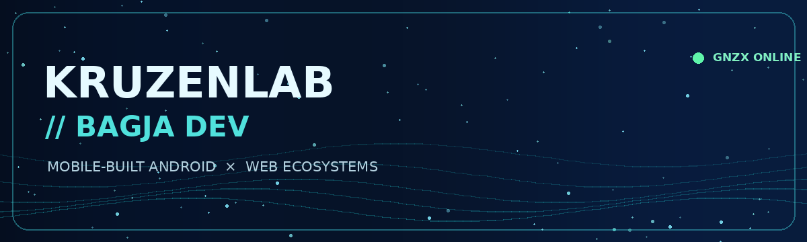
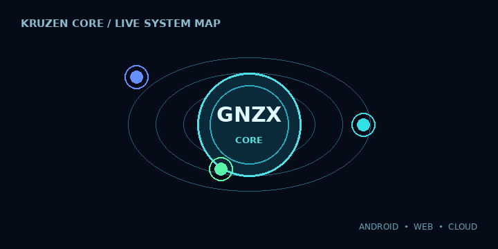
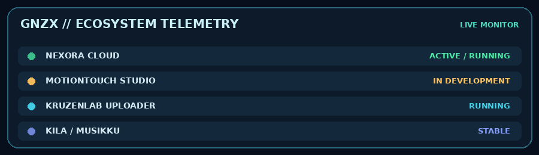
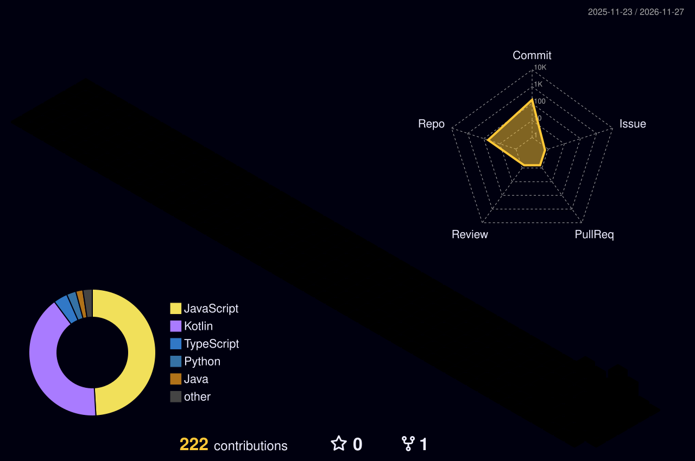

<div align="center">



<br/>


<a href="https://bagja.dev"></a>

### `GANDZAR SUBAGJA` · `DEV BAGJA` · `PROJECT GNZX`
**Indonesia · Garut / Bandung, West Java**

*Building Android & Web ecosystems straight from a smartphone.*  
**Code anywhere, ship everywhere.**


</div>

---

## `01 / GNZX SYSTEM CONSOLE`


<div align="center">
  
  <sub>GNZX CORE // ANDROID • WEB • CLOUD • AUTOMATION</sub>
</div>

## `02 / BUILDER IDENTITY`

```yaml
identity:
  name: Gandzar Subagja
  aliases: [DEV BAGJA, KRUZENLAB]
  project_id: GNZX
  base: Indonesia / Garut–Bandung, West Java

mission: "Building Android & Web ecosystems straight from a smartphone."
principle: "Code anywhere, ship everywhere."

roles:
  - Mobile-First Android & Fullstack Web Developer
  - AI Workflow Builder
  - Audio & Media App Creator

workstation:
  mode: Mobile-Only
  device: Android 12
  compute: Cloud IDE + GitHub Actions
  desktop_required: false
  output: APK + Web

toolchain:
  android: [Kotlin, Jetpack Compose, Android SDK]
  web: [Next.js, TypeScript, HTML5, CSS3, Capacitor]
  delivery: [GitHub Actions, CI/CD, Vercel]
  ai: [Google AI Studio]
```

## `03 / ECOSYSTEM TELEMETRY`

<div align="center">
  
</div>

```console
$ systemctl status kruzen-stack

● kruzen-stack.service - KRUZENLAB Project Ecosystem
   Loaded: loaded (GNZX workspace)
   Active: running

   ● nexora-cloud.service        active (running)
   ● motiontouch-studio.service  in_dev
   ● kruzen-uploader.service     running
   ● kila-media.service          stable
```

| Project | State | Description | Core stack |
|---|---|---|---|
| **Nexora Cloud** | 🟢 `active / running` | Hybrid Android personal cloud storage & file explorer with Telegram, Drive and GitHub integrations. | Kotlin · Jetpack Compose |
| **MotionTouch Studio** | 🟡 `in_dev` | Android screen/cursor recorder and keyframe video editor. | Android · Media tooling |
| **KruzenLab Uploader** | 🟢 `running` | GitHub OAuth 2.0 batch repository manager for Android APK and Next.js Web. | Next.js · TypeScript |
| **KILA / MusikKu** | 🔵 `stable` | Universal Android media player, 8D audio/EQ studio and social media downloader. | Kotlin · Android Media |

## `04 / K-01 CYBER MASCOT`

<div align="center">
  
  <br/>
  <b>K-01 // NEON HELMET UNIT</b><br/>
  <sub>Procedural 3D mesh · Cyan core · Rotational idle animation</sub>
</div>

<details>
<summary><b>↳ Open 3D asset & generation notes</b></summary>

- [View STL model](./assets/kruzen_bot.stl)
- Generator: [`clawd/make_stl.py`](./clawd/make_stl.py)
- Renderer: [`clawd/render.py`](./clawd/render.py)

The mascot is generated procedurally; the STL is the mesh export and the GIF is its rendered preview.

</details>

## `05 / TOOLCHAIN GRID`

<div align="center">


<br/><br/>


</div>

## `06 / MOBILE WORKSTATION`

<div align="center">

| Layer | Environment |
|:--|:--|
| Device | Android 12 |
| Workspace | Mobile-only / no-PC setup |
| Development | Cloud IDE + GitHub |
| Build engine | GitHub Actions |
| Android output | APK / Android SDK |
| Web output | Next.js / Vercel |

**Pocket-sized workstation. Cloud-sized compute.**

</div>

## `07 / CONTRIBUTION DIMENSION`

<div align="center">
  
  <sub>Generated automatically with GitHub Actions · profile-3d-contrib</sub>
</div>

## `08 / CONNECT & DEPLOY`

<div align="center">

<a href="https://bagja.dev"></a>
<a href="https://kruzen-uploader.vercel.app"></a>

<br/><br/>

**KRUZENLAB // GNZX**  
*Designed to build. Engineered to ship.*

<sub>Made on Android 12 · Powered by cloud compute · Deployed everywhere</sub>

</div>
