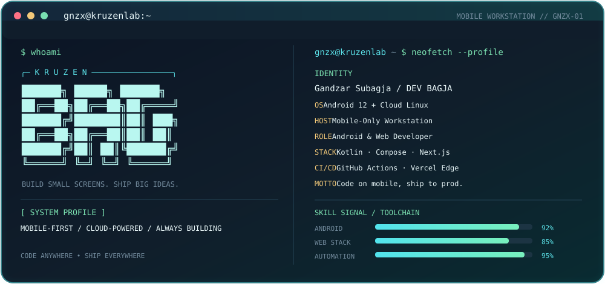
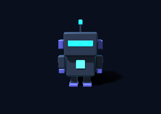

<!-- ============================================================
  KRUZENLAB // BAGJA DEV — profile built 100% original for GNZX.
  Ganti semua token [USERNAME_GITHUB_SAYA] dengan username GitHub kamu.
============================================================ -->

<p align="center">
  
</p>

<p align="center">
  
</p>

<p align="center">
  <br/>
  <sub>🤖 <b>GNZX-01 “Kruzen Bot”</b> — mobile-native build droid · 360° SDF raymarched loop</sub>
</p>

<details>
<summary><b>🤖 Inspect GNZX-01 in 3D</b> — open the STL in GitHub’s model viewer (drag · scroll)</summary>

- Model file: [`assets/kruzen_bot.stl`](./assets/kruzen_bot.stl)
- Geometry source: [`clawd/make_stl.py`](./clawd/make_stl.py) — ASCII STL writer, helmet-droid build
- Animation source: [`clawd/render.py`](./clawd/render.py) — numpy raymarcher → `assets/kruzen_bot.gif`
- Rebuild: `python3 clawd/make_stl.py` lalu `python3 clawd/render.py 0 28`
</details>

<p align="center">
  <a href="https://readme-typing-svg.demolab.com">
    
  </a>
</p>

<p align="center">
  
  
  
  <a href="https://bagja.dev"></a>
  <a href="https://kruzen-uploader.vercel.app"></a>
</p>

<p align="center">
  
  
  
</p>

---

### `> cat ~/kruzenlab.yaml`

```yaml
identity:
  name:       Gandzar Subagja
  alias:      DEV BAGJA · KRUZENLAB
  project_id: GNZX
  location:   Garut / Bandung, West Java — Indonesia
  web:        https://bagja.dev
  playground: https://kruzen-uploader.vercel.app

role: Mobile-First Android & Fullstack Web Developer
      · AI Workflow Builder · Audio & Media App Creator

environment:
  os:           Android 12 + Cloud Linux (GitHub Actions runners)
  hardware:     smartphone-only workstation — zero PC setup
  compile:      Kotlin / Compose APKs + Next.js web, built on-device and in CI
  deploy:       GitHub Actions → Vercel Edge + APK release pipeline

philosophy: "Building Android & Web ecosystems straight from a smartphone."
motto:      code anywhere, ship everywhere.

currently:
  - Nexora Cloud      — hybrid Android personal cloud & file explorer
  - MotionTouch Studio — screen recorder & keyframe video editor
  - KruzenLab Uploader — GitHub OAuth batch repository manager (APK + web)
  - KILA / MusikKu     — universal media player, 8D audio & EQ studio
```

---

### `> systemctl status kruzen-stack`

| Unit | State | Stack & What It Does |
|:--|:--:|:--|
| ☁️ **nexora-cloud** <br/>[repo](https://github.com/[USERNAME_GITHUB_SAYA]/nexora-cloud) |  | Hybrid Android personal cloud storage & file explorer — Jetpack Compose with Telegram / Drive / GitHub integration |
| 🎬 **motion-touch-studio** <br/>[repo](https://github.com/[USERNAME_GITHUB_SAYA]/motion-touch-studio) |  | Android screen / cursor recorder with keyframe-based video editing timeline |
| 🚀 **kruzenlab-uploader** <br/>[web](https://kruzen-uploader.vercel.app) · [repo](https://github.com/[USERNAME_GITHUB_SAYA]/kruzenlab-uploader) |  | GitHub OAuth 2.0 batch repository manager — native Android APK + Next.js web client |
| 🎧 **kila-musikku** <br/>[repo](https://github.com/[USERNAME_GITHUB_SAYA]/kila-musikku) |  | Universal Android media player — 8D audio, EQ studio & social media downloader |

---

### `> cat ~/toolbox`

<p align="center">
  
</p>

<p align="center">
  
  
  
  
  
  
  
  
  
  
</p>

---

### `> htop --user gnzx`

<p align="center">
  
  
</p>
<p align="center">
  
</p>

---

### `> render --3d contributions`

<p align="center">
  
</p>

<p align="center"><sub>graph di-regenerate otomatis oleh <code>.github/workflows/3d-contrib.yml</code> setiap 12 jam</sub></p>

---

### `> tail -f deploy.log`

<p align="center">
  <picture>
    <source media="(prefers-color-scheme: dark)" srcset="https://raw.githubusercontent.com/[USERNAME_GITHUB_SAYA]/[USERNAME_GITHUB_SAYA]/output/snake-dark.svg" />
    
  </picture>
</p>

---

<p align="center">
  
</p>

<p align="center"><code>// built from a pocket device · Kotlin + Compose · Next.js · shipped on the edge ⚡</code></p>

<p align="center"><sub>© 2026 KRUZENLAB / DEV BAGJA — original design, mobile-first stack.</sub></p>

<p align="center">
  
</p>
